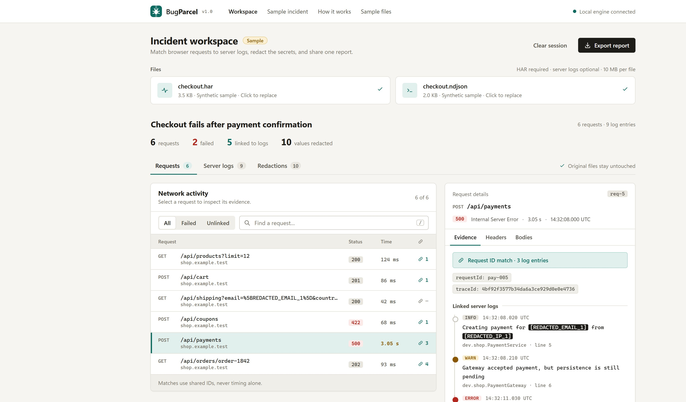
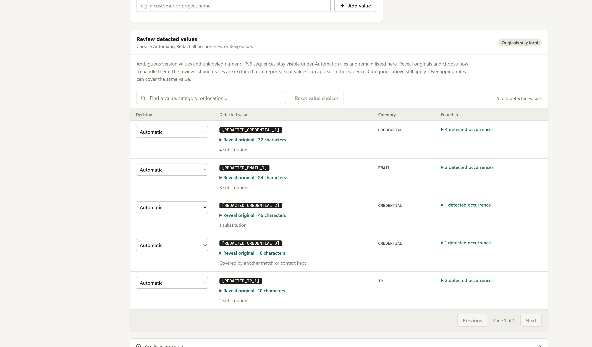

# BugParcel

**Connect browser requests to backend logs. Share the evidence.**

When a checkout fails, the useful evidence often lives in two places: a HAR recording from the browser and a server log file. BugParcel connects matching identifiers, lets you review redactions, and packages the result as a report someone can open without installing anything.

A local Java 17 / Spring Boot application with a dependency-free browser interface. No account, database, analytics, AI service, or cloud upload.



## Try it

Requires **Java 17+** to run the packaged app. Building from source also requires **Maven 3.9+**.

```sh
mvn verify
java -jar target/bugparcel-1.0.0.jar
```

Open **http://127.0.0.1:8087** and click **Open the sample incident**. Or open http://127.0.0.1:8087/?sample=1 to jump directly into the demo.

On Windows, double-click `start-bugparcel.cmd`. It uses the built JAR when available and builds it otherwise. To rebuild after changes:

```powershell
.\scripts\run.ps1 -Build
```

Use another port with `--server.port=8090`, `BUGPARCEL_PORT=8090`, or `scripts/run.ps1 -Port 8090`.

The Windows launchers also use a process-local Java socket-directory option to avoid a JDK selector-pipe failure with some Windows temporary paths. The JDK falls back to a TCP pipe; no Windows security settings or global environment variables are changed. See the [OpenJDK pipe implementation](https://github.com/openjdk/jdk21u/blob/master/src/java.base/windows/classes/sun/nio/ch/PipeImpl.java).

After a successful build, create a portable ZIP with `scripts/package.ps1`. It contains the runnable JAR, Windows launcher, instructions, and license. Java 17+ is the only runtime prerequisite.

## Command line

The same JAR is also a CLI. Commands never start a server or open a port, and the report starts in well under a second.

```sh
java -jar target/bugparcel-1.0.0.jar sample                      # writes ./bugparcel-sample/
java -jar target/bugparcel-1.0.0.jar report checkout.har --logs app.log -o report.html
java -jar target/bugparcel-1.0.0.jar review checkout.har --logs app.log
```

The portable ZIP adds `bugparcel.cmd` and `bugparcel` launchers, so these become `bugparcel report ...`.

```sh
# Pipe logs in, write Markdown to stdout (the summary goes to stderr)
kubectl logs deploy/api | bugparcel report checkout.har --logs - -o - --format md > incident.md

# Several log files, mixed formats; also redact an exact value
bugparcel report checkout.har --logs api.log --logs worker.ndjson --redact "Acme Corp" -o report.html

# See what was detected (originals hidden unless --reveal), then decide
bugparcel review checkout.har --logs app.log
bugparcel report checkout.har --logs app.log --keep 056e8dd9 --force 9a31c0de --strict
```

| Command | Purpose |
| --- | --- |
| `report <file.har>` | Correlate, redact, and write HTML (default), Markdown, or JSON. The format follows the `-o` extension or `--format`. |
| `review <file.har>` | List each detected value with category, uses, and status. `--json` for tooling. Use any unique 8+ character ID prefix with `--keep` or `--force`. |
| `sample` | Write the fictional checkout incident to try it. |
| `serve [--port N]` | Start the web interface (also the default with no command). |

Exit codes are `0` success, `1` failure (unreadable file, invalid input), `2` usage error, and `3` when `--strict` finds ambiguous address values that automatic rules kept visible, which makes it usable as a CI gate. Error messages never echo input content. Logs may be UTF-8 or UTF-16 (what PowerShell 5 `>` writes); `--logs -` reads standard input. Run `bugparcel help report` for every option.

The CLI uses the identical analysis and redaction code as the web interface, so the same limits and caveats apply. Redaction is still pattern-based: run `review` before sharing a report.

## The sample incident

A synthetic shop checkout has six browser requests and nine server log entries:

- A product request and cart update succeed.
- An expired coupon returns `422`.
- A payment request returns `500`; its shared request ID links three log entries, including a database connection timeout.
- An order poll shares the payment trace, so it is labeled as shared trace context.
- A shipping request has no matching identifier. Two unrelated log entries remain unlinked.

Expected results: **6 requests · 2 failed · 5 linked · 9 logs · 2 unlinked logs**. The data is fictional, including all credentials and contact details. Download the files from **Sample files** in the header to try importing them yourself.

## What works

- Import HAR recordings, newline-delimited JSON logs, JSON log arrays, and Spring Boot text logs with multiline stack traces.
- Inspect HTTP status, duration, headers, optional text bodies, correlation IDs, and linked logs.
- Filter failed or unlinked requests; search requests and logs; jump from a log entry to its request.
- Match request IDs first, correlation IDs second, and trace IDs third. Repeated IDs are labeled as shared context. No matches are inferred from timestamps.
- Replace credentials, cookies, known sensitive fields, email addresses, IPv4/IPv6 literals, and explicitly labeled phone numbers with consistent placeholders.
- Add exact custom values for customer names, internal hostnames, or other data that automatic detection does not cover.
- Turn redaction categories on or off and preview the resulting evidence. Bodies are excluded by default.
- Review every detected value with its categories, source locations, and substitution count. Choose **Automatic**, **Redact all occurrences**, or **Keep value**. Ambiguous address-like values remain listed even when automatic rules leave them visible. Search and pagination cover the full detected list.
- Export standalone HTML, Markdown, or normalized JSON. Export always re-analyzes the original in-memory input with the current settings.
- Keyboard-accessible controls, responsive layouts, visible focus states, a `/` shortcut for request search, and light and dark themes that follow your system setting.



## Import your own incident

1. In Chrome DevTools, open **Network**, clear previous traffic, and reproduce the problem. Export a HAR recording. A short recording is easiest to investigate.
2. Add server logs from the same incident. JSON logs give the most reliable field extraction.
3. Select a failed request. Inspect the linked entries and stack traces. Shared trace context is broader than a single request.
4. Open **Redactions**, review the defaults and the detected-value list, and add exact custom values where needed. Choose **Keep value** for a false positive, or **Redact all occurrences** for an ambiguous value that is an address. **Automatic** restores the context policy. Category switches still apply; another overlapping rule can hide a kept value.
5. Inspect the evidence, then download a report. Everything is held in memory; reload or clear the session to discard it.

### Supported identifiers

| Browser headers | Server log fields |
| --- | --- |
| `x-request-id`, `request-id` | `requestId`, `request_id`, `request.id`, nested `request.id` |
| `x-correlation-id`, `correlation-id` | `correlationId`, `correlation_id`, `correlation.id` |
| W3C `traceparent`, `x-b3-traceid`, B3 single header | `traceId`, `trace_id`, `trace.id`, nested `trace.id`, `traceparent` |

Headers can come from the request or response. JSON fields are recognized at the top level and in `mdc`, `context`, and `labels`. Trace IDs must be 16 or 32 hexadecimal characters and cannot be all zeros. W3C version-00 traceparents require the standard length and a nonzero parent ID.

Plain text logs recognize `requestId=...`, `request_id=...`, `traceId=...`, `trace_id=...`, `correlationId=...`, `correlation_id=...`, and `traceparent=...` after a timestamp and level.

### Example structured log

```json
{"@timestamp":"2026-11-07T14:32:11Z","level":"ERROR","logger_name":"dev.shop.CheckoutService","message":"Database connection timed out","mdc":{"requestId":"pay-005","traceId":"4bf92f3577b34da6a3ce929d0e0e4736"}}
```

The browser request must contain the same ID for correlation to work. BugParcel does not retroactively add IDs to logs or infer a root cause from an error message.

## Privacy and limits

The server binds to `127.0.0.1`. Incident content is not written to disk by the application. The browser holds the original inputs in memory; requests send them only to the local Java process. There is no external runtime service or CDN. Downloaded reports are files you choose to retain and share. JVM heap dumps, operating-system paging, browser extensions, and developer tools are outside this application's storage guarantees.

Redaction is pattern-based, **not a guarantee that all sensitive information has been removed**. IPv6 numeric literals are validated locally without hostname lookup. Bare `::` and `:` separators are not automatically detected; use an explicit custom value if an unspecified IPv6 literal needs hiding. Unlabeled eight-group decimal sequences such as `10:20:30:40:50:60:70:80` are listed as ambiguous and kept automatically. An address field, explicit label such as `peer=`, or brackets makes the same numeric sequence an automatic address match.

Phone detection requires a recognized field or label, such as `phone`, `mobile`, or `telephone`, with 7–15 digits in supported contiguous/grouped forms (up to five groups). Common year-first and day-first dotted/dashed dates are rejected. An extracted phone prefix ending before a timestamp colon is rejected rather than retrying a shorter prefix. Unlabeled phone numbers, names, arbitrary identifiers, and unknown secret formats still require custom values and review. Encoded query parameters are inspected; arbitrary encoded paths, base64 data, compressed data, and binary content are not decoded. Bodies are optional and truncated at 30,000 characters. Keep original files for complete evidence.

Short/common credentials (under four characters, short all-digit values, or literals such as `true`) are hidden within their sensitive fields or explicitly labeled spans. They are not replaced throughout unrelated text. Automatic global matches use token boundaries. Exact custom values intentionally remain substring matches, including inside displayed correlation IDs; links are formed before redaction, and the interface/report explain this when an ID changes.

The automatic boundary policy treats `_` and `-` as word characters. It preserves `real-secret-suffix`, but also leaves a known secret joined as `token_<secret>` or `prefix-<secret>` unchanged under global matching. Explicitly labeled credential spans and custom substring values provide coverage for such formats. This precision/coverage trade-off should be considered when reviewing a real incident.

Only explicit version-field shapes such as `version=`, `v=`, JSON `version`, and `x-app-version` get version treatment. Ordinary prose such as `Failed to build 10.0.0.12 image` and `Using release 10.1.2.3 now` does not suppress IP redaction. Version-looking literals are always detected and listed as ambiguous findings; their version-context occurrences default to visible, while actual address occurrences of the same value are masked. **Redact all occurrences** overrides this ambiguity policy, subject to enabled categories. **Keep value** takes precedence if both choices are sent through the API. Export notices and report notes identify automatic ambiguity decisions that left values visible.

The local analysis response includes original detected values for the review view, with originals collapsed by default in the interface. The exported incident excludes this review list and its stable IDs. Values explicitly kept by the user can appear in exported evidence. Clearing the session removes rendered review originals as well as source inputs and review choices.

The browser accepts 10 MiB per file. The API caps input strings at 12 million characters and the total request body at 28 MB, including chunked uploads. Other bounds: 10,000 browser requests, 50,000 log entries, 100,000 text log lines, 20,000 unique redaction candidates, 50 custom values. A full HAR JSON tree and normalized evidence are held in memory; this is an incident-sized tool, not a streaming log warehouse. Long fields are truncated with a visible analysis note. Malformed JSON log lines are skipped with a count.

HTML reports escape imported strings and carry a restrictive CSP with no scripts or external resources. Markdown exports use code fences long enough to contain imported backticks. A local origin/host guard blocks cross-origin API calls and DNS rebinding hosts. See [architecture and trust boundaries](docs/architecture.md).

## API

| Method | Route | Purpose |
| --- | --- | --- |
| GET | `/api/health` | Local engine status |
| GET | `/api/sample` | Fictional HAR and logs |
| POST | `/api/analyze` | Normalize, correlate, and redact |
| POST | `/api/export/html` | Standalone HTML report |
| POST | `/api/export/markdown` | Markdown report |
| POST | `/api/export/json` | Normalized incident JSON |

All POST endpoints use the same JSON input:

```json
{
  "har": "{\"log\":{\"entries\":[...]}}",
  "logs": "{\"level\":\"ERROR\",\"message\":\"...\"}",
  "title": "Checkout failure",
  "enabledCategories": ["CREDENTIAL", "EMAIL", "IP", "PHONE", "CUSTOM"],
  "customValues": ["customer-name"],
  "includeBodies": false,
  "excludedFindingIds": [],
  "redactFindingIds": []
}
```

Omit `enabledCategories` to enable every category. An explicit empty array disables all categories. The normalized export contains no original input files, original filenames, or private redaction mapping. IDs internal to the report (`req-1`, `log-1`) preserve links after redaction.

`/api/analyze` also returns `findings`, separate from `incident`. Each finding includes a stable ID, original value, categories, source locations, field-scoping flag, substitution count, and ambiguity reasons/counts. Pass IDs in `excludedFindingIds` to keep them or `redactFindingIds` to override ambiguity and redact them. Omit an ID from both sets for Automatic. The same choices are accepted by all export routes. IDs are local review identifiers, not bearer credentials. Export schema `1.2` records exclusion/explicit-redaction counts, an automatically kept ambiguity count, and actual per-category replacement counts, with no original review list or IDs.

## Verification

```sh
mvn verify
node --check src/main/resources/static/app.js
```

The automated suite covers correlation precedence and identifier namespaces, shared traces, unmatched evidence, structured and multiline logs, malformed inputs, secret removal from every export, encoded query parameters, consistent placeholders, overlapping custom rules, concurrent analysis isolation, hostile HTML/Markdown, origin/host guards, and request size limits. CI builds the runnable JAR on Java 17. There is no frontend dependency installation or bundling step.

See [local verification notes](docs/verification.md) for the checked browser workflow and runtime details.

## Docker

```sh
docker build -t bugparcel .
docker run --rm -p 127.0.0.1:8087:8087 bugparcel
```

The container runs as a non-root user. The container itself listens on all interfaces so Docker forwarding works; keep the host port bound to loopback as shown. This local application has no multi-user authentication and should not be exposed as a public service.

## Project layout

```text
src/main/java/dev/bugparcel/
  analysis/   HAR/log parsers, identifier extraction, correlation, redaction
  api/        HTTP endpoints, validation, local origin/host and size guards
  export/     Standalone HTML and Markdown generation
  model/      Immutable API and evidence records
src/main/resources/
  static/     Dependency-free interface: HTML, CSS, ES modules
  samples/    Synthetic checkout incident
src/test/     Behavioral and API integration tests
```

Built by [Roman Sushkin](https://github.com/Nikkilodeonee). MIT licensed.
