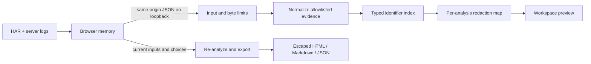

# Architecture and design decisions

## Data path

One Spring Boot executable serves the static interface and JSON API. No database or stateful incident session is needed. Each analysis owns its normalized evidence and redaction map; concurrent requests do not share either. The original inputs live in browser memory until refresh or clearing the session. The Java process releases request-local objects for garbage collection after producing the response.

## Correlation

`Identifiers` normalizes only known ID fields. Trace IDs are validated and lowercased; opaque request/correlation IDs retain their case. The join key includes the identifier type, so a request ID cannot match a trace ID merely because the strings happen to be equal.

`Correlator` indexes log IDs by typed identifier. For each request it selects the first available match in this order: request ID, correlation ID, trace ID. A stronger match is not widened by merging logs from a broader trace or workflow. The order of logs in each result follows their original file order. Reused browser IDs are explicitly labeled as shared context. A matching ID establishes a relationship, not a diagnosis or causal proof. No timestamp proximity heuristic is used.

## Redaction

The redactor first discovers known sensitive values in structured headers, URLs, JSON bodies, and text. Pattern definitions and context policies live in `RedactionPatterns`; discovery, review decisions, and replacement live in `Redactor`, with explicit methods for each input type. A per-analysis trie performs left-to-right longest-active-value replacement without rewriting inside newly generated placeholders. Disabled or excluded matches do not suppress other enabled matches inside the same text.

Automatic global matches require token boundaries, with hyphens and underscores treated as word characters. This preserves suffixed identifiers and also leaves `token_<secret>` untouched unless a labeled credential span or explicit custom rule covers it. Short/common credential values are scoped to their sensitive fields or labeled spans, so `token=5` does not change `attempt=5`. Custom values remain explicit substring matches.

IP discovery is independent of automatic replacement policy. Every valid address candidate is listed, including candidates in explicit version fields. Version recognition uses a known-key list and a required `:`/`=` delimiter in text; ordinary build/release prose cannot suppress an address. Version occurrences and unlabeled eight-group decimal IPv6 sequences are marked ambiguous and kept automatically. Address keys, explicit address labels, and brackets disambiguate numeric IPv6. Ambiguity reasons and automatically kept occurrences are tracked per occurrence; matching the same value elsewhere does not erase its version context. A report warning counts values left visible by this policy.

IPv6 candidates require at least one hexadecimal digit and are validated by the JDK; bare separators are ignored and hostname strings cannot reach the address parser. Phone detection is limited to explicit labels or recognized field names, 7–15 digits in bounded grouped shapes, and complete spans. Common dotted/dashed dates and prefixes ending before timestamp colons are rejected. Names use custom values.

The same original value maps to the same placeholder throughout the incident. Applicable category switches control the rule. Review choices are Automatic, Redact all occurrences (override ambiguity), and Keep value (exclude); Keep takes precedence if both API sets contain an ID. Reset clears both sets. Explicit redact choices still respect category switches and automatic token boundaries; custom rules retain their documented literal behavior. Review IDs are SHA-256 identifiers of values, stable across re-analysis and added custom rules; they are not exported or used for authentication. The analysis response carries the review list separately from the exported `Incident`, allowing local original-value review while keeping the mapping outside the report model. A kept value can still be covered by a different overlapping redaction. Counts distinguish detected occurrences from actual substitutions.

Structured bodies are parsed where possible, allowing nested fields and JSON property names to be inspected. Encoded query parameters and form body values are decoded for inspection. Binary/base64 response bodies are omitted. This is a deliberately bounded detector, with visible defaults and user-controlled exact custom values. The interface never labels a report as guaranteed secret-free.

## Export boundary

Exports accept the source inputs and current choices, not a client-authored report model. The service runs normalization, matching, and redaction again. Only the normalized incident is passed to the exporter. HTML templates escape every imported string, use no scripts, and include a restrictive CSP. Markdown text escapes inline markup and sizes its code fences around imported backticks. JSON export uses Jackson serialization of the report model.

## Local HTTP boundary

The application binds to loopback. A servlet filter checks the Host and any Origin header, disallows cross-site POSTs, requires JSON input, and sets no-store/security headers. A bounded servlet input stream enforces the total byte limit even when Content-Length is absent. Jackson also limits nesting and string size; parsers constrain entry counts and field lengths. API errors do not echo source content or stack traces. There are no CORS grants, external resources, telemetry SDKs, or outbound HTTP calls.

Local processes with access to the same user account are trusted. This is not an authenticated remote service. Host binding changes, reverse proxies, public hosting, and multi-user deployment would require a separate design.

## Deliberate scope

The first release targets incident-sized HAR files and Spring Boot-compatible logs. It parses JSON trees in memory and does not stream multi-gigabyte files. The data is not persisted, so reload recovery and cross-device synchronization are absent. These choices keep the core workflow inspectable and useful without asking people to upload private logs or provision infrastructure.

The next extensions should follow real user evidence: adapters for a specific team's log format, a Java command-line entry point, or more redaction formats. Keep claims about supported formats tied to fixtures and behavioral tests.
