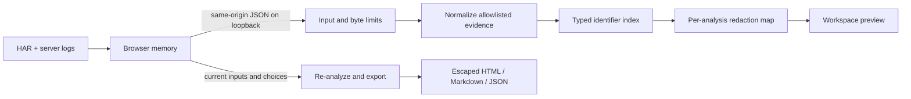

# Architecture and design decisions

## Data path

One Spring Boot executable serves the static interface and JSON API. No database or stateful incident session is needed. Each analysis owns its normalized evidence and redaction map; concurrent requests do not share either. The original inputs live in browser memory until refresh or clearing the session. The Java process releases request-local objects for garbage collection after producing the response.

## Correlation

`Identifiers` normalizes only known ID fields. Trace IDs are validated and lowercased; opaque request/correlation IDs retain their case. The join key includes the identifier type, so a request ID cannot match a trace ID merely because the strings happen to be equal.

`Correlator` indexes log IDs by typed identifier. For each request it selects the first match in this order: requestId, cfRay, correlationId, traceId, awsTraceId, azureRootId. A stronger match is not widened by merging broader context. Log references retain file order. Reused browser IDs are labeled as shared context. AWS uses Root, Cloudflare strips the datacenter suffix, and Azure hierarchical roots have their own namespace. Google/Sentry normalize compatible hexadecimal trace IDs. A matching ID establishes a relationship, not a diagnosis or causal proof.

`LogParser.parseDetected` detects each entry independently and returns format counts with the normalized entries. Mixed sources retain physical line references; Java/Python stack continuations attach to the preceding entry. Docker JSON unwraps one envelope with bounded normalization. Unknown text stays visible without inferred IDs; malformed JSON is counted and skipped. Shared Java format shapes cannot reliably distinguish Logback from Log4j2, so they use one label.

`CorrelationInsights` adds structured diagnostics when zero requests link. Its metadata contains known type labels and internal references only, so raw values cannot bypass redaction. Opt-in timestamp hints live in a separate collection in schema 1.3 and never mutate confirmed links or counts. Zoned timestamps only, ±2 seconds from request start, three nearest unlinked entries, and contradictory IDs excluded. Binary search over sorted log times bounds lookup; global and dense-window limits produce warnings. Hints reuse sanitized evidence in every export.

## Redaction

The redactor first discovers known sensitive values in structured headers, URLs, JSON bodies, and text. Pattern definitions and context policies live in `RedactionPatterns`; discovery, review decisions, and replacement live in `Redactor`, with explicit methods for each input type. A per-analysis trie performs left-to-right longest-active-value replacement without rewriting inside newly generated placeholders. Disabled or excluded matches do not suppress other enabled matches inside the same text.

Automatic global matches require token boundaries, with hyphens and underscores treated as word characters. This preserves suffixed identifiers and also leaves `token_<secret>` untouched unless a labeled credential span or explicit custom rule covers it. Short/common credential values are scoped to their sensitive fields or labeled spans, so `token=5` does not change `attempt=5`. Custom values remain explicit substring matches.

IP discovery is independent of automatic replacement policy. Every valid address candidate is listed, including candidates in explicit version fields. Version recognition uses a known-key list and a required `:`/`=` delimiter in text; ordinary build/release prose cannot suppress an address. Version occurrences and unlabeled eight-group decimal IPv6 sequences are marked ambiguous and kept automatically. Address keys, explicit address labels, and brackets disambiguate numeric IPv6. Ambiguity reasons and automatically kept occurrences are tracked per occurrence; matching the same value elsewhere does not erase its version context. A report warning counts values left visible by this policy.

IPv6 candidates require at least one hexadecimal digit and are validated by the JDK; bare separators are ignored and hostname strings cannot reach the address parser. Phone detection is limited to explicit labels or recognized field names, 7–15 digits in bounded grouped shapes, and complete spans. Common dotted/dashed dates and prefixes ending before timestamp colons are rejected. Names use custom values.

The same original value maps to the same placeholder throughout the incident. Applicable category switches control the rule. Review choices are Automatic, Redact all occurrences (override ambiguity), and Keep value (exclude); Keep takes precedence if both API sets contain an ID. Reset clears both sets. Explicit redact choices still respect category switches and automatic token boundaries; custom rules retain their documented literal behavior. Review IDs are SHA-256 identifiers of values, stable across re-analysis and added custom rules; they are not exported or used for authentication. The analysis response carries the review list separately from the exported `Incident`, allowing local original-value review while keeping the mapping outside the report model. A kept value can still be covered by a different overlapping redaction. Counts distinguish detected occurrences from actual substitutions.

Structured bodies are parsed where possible, allowing nested fields and JSON property names to be inspected. Encoded query parameters and form body values are decoded. `AdditionalDetectors` supplies provider formats, private-key blocks, and opt-in checksum/entropy tests. `DecodedContent` inspects printable UTF-8 base64/base64url and JWT claims with request-local byte/attempt/depth bounds, including bounded gzip decompression. Sensitive encoded containers become placeholders; supported encoded HAR bodies are normalized to text first. Invalid/binary bodies are omitted with notes. Original values resembling placeholders cannot bypass discovery; generated markers avoid known-value collisions.

`RedactionPolicy` reads bounded primitive-only YAML and compiles patterns with linear-time RE2/J. Custom rules and allowlists match explicit location globs, so a rule or exception in one field cannot silently spread to another. Keep and allowlist choices precede forced/automatic redaction. Policy text and review originals are separate from the report model. Profile defaults and explicit overrides are shared by API, CLI, and UI.

`RedactionSelfCheck` runs over the final normalized evidence used by every exporter. It rescans patterns/decoded content and independently checks surviving long known credentials/custom values using bounded Aho-Corasick lookup, including boundary-joined strings. Only counts, categories, internal request/log IDs, intentional-choice flags, and completion state reach `incident.security`; raw values/hashes/policy text never do. A zero count covers included evidence and the selected detector profile only. Shared detector blind spots remain possible. See [detailed limits and semantics](redaction.md).

## Export boundary

Exports accept the source inputs and current choices, not a client-authored report model. The service runs normalization, matching, and redaction again. Only the normalized incident is passed to the exporter. HTML templates escape every imported string, use no scripts, and include a restrictive CSP. Markdown text escapes inline markup and sizes its code fences around imported backticks. JSON export uses Jackson serialization of the report model.

Schema 1.5 adds `ReportInsights`, derived solely from sanitized evidence: completion-time events, request timing rows, summary references/counts, and hashed error signatures. `EvidenceTime` rejects incomplete/unzoned/out-of-range times. SVG geometry is generated from finite numeric data; labels are escaped. `ReportSections` shares chart, summary, grouping, theme, and print rendering between exporters.

`IncidentComparison` re-analyzes both sources under the current privacy settings. Route/occurrence pairing and placeholder normalization are explicit comparison rules, separate from `Correlator`. Two-request comparisons select only confirmed linked evidence and rescan it; scan/redaction totals retain source provenance. `RequestSnippets` receives sanitized evidence only and generates escaped text or POSIX shell templates with required replacement variables. It has no HTTP client or process execution capability. See [detailed report semantics](reports.md).

## Local HTTP boundary

The application binds to loopback. A servlet filter checks the Host and any Origin header, disallows cross-site POSTs, requires JSON input, and sets no-store/security headers. A bounded servlet input stream enforces the total byte limit even when Content-Length is absent. Jackson also limits nesting and string size; parsers constrain entry counts and field lengths. API errors do not echo source content or stack traces. There are no CORS grants, external resources, telemetry SDKs, or outbound HTTP calls.

Local processes with access to the same user account are trusted. This is not an authenticated remote service. Host binding changes, reverse proxies, public hosting, and multi-user deployment would require a separate design.

## Deliberate scope

The first release targets incident-sized HAR files and Spring Boot-compatible logs. It parses JSON trees in memory and does not stream multi-gigabyte files. The data is not persisted, so reload recovery and cross-device synchronization are absent. These choices keep the core workflow inspectable and useful without asking people to upload private logs or provision infrastructure.

The next extensions should follow real user evidence: adapters for a specific team's log format or more redaction formats. Keep claims about supported formats tied to fixtures and behavioral tests.
